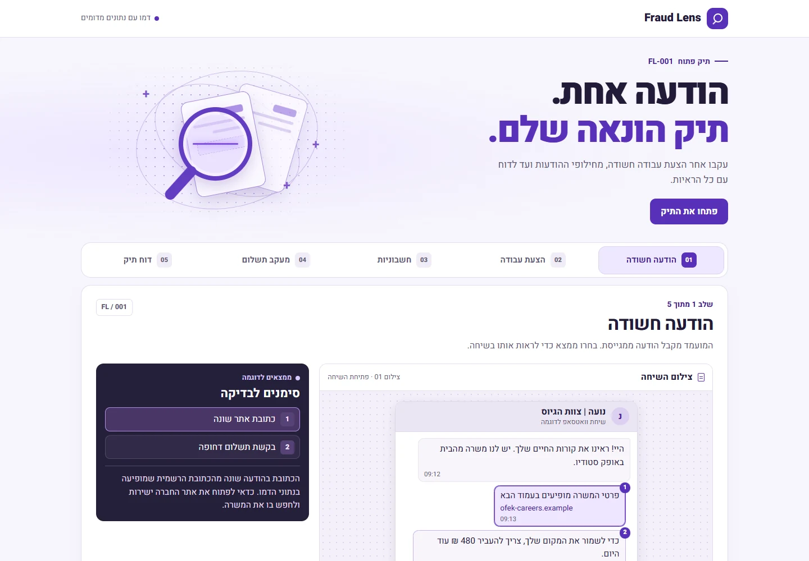

# Fraud Lens

Fraud Lens reviews suspicious-message screenshots with OpenAI. It also includes an interactive English demo that follows one fictional job scam from the first message to an evidence report.



## Run the demo

**[Open the live demo](https://assafsela-ai.github.io/fraud-lens/)**

Open [index.html](./index.html) in your browser and select **Open the case**. The demo runs locally without an account, file uploads, or an API key.

You can also serve the repository over local HTTP.

```sh
python -m http.server 8000 --bind 127.0.0.1
```

Open `http://127.0.0.1:8000`. To deploy with GitHub Pages, use the root folder of the `main` branch. The site is static and uses relative paths.

## Analyze your own screenshot

**[Open the public screenshot analyzer](https://assafsela-ai.github.io/fraud-lens/analyze.html).** No Fraud Lens account or local server is needed. Choose a PNG, JPEG, or WebP screenshot (up to 10 MB), enter your OpenAI API key, and select a model. The result includes a risk assessment, supporting evidence, next steps, and what the screenshot could not establish.

The public analyzer sends your screenshot and key directly from your browser to OpenAI’s Responses API. Fraud Lens clears the key field on submission and does not save keys, images, or results. Use a restricted OpenAI project key and crop any details you do not need reviewed. Model access and usage charges depend on your OpenAI project. See [OpenAI API data controls](https://developers.openai.com/api/docs/guides/your-data) for how OpenAI handles submitted data.

### Optional local server

You can route OpenAI requests through the included local server with **Node.js 22 or later**. It uses Node’s built-in APIs and needs no package installation.

```sh
git clone https://github.com/assafsela-ai/fraud-lens.git
cd fraud-lens
npm start
```

Open [the local analyzer](http://127.0.0.1:8787/analyze.html). The server listens on `127.0.0.1`. Set `FRAUD_LENS_PORT` if the default port is occupied.

## Demo walkthrough

1. Open the fictional WhatsApp chat and select a finding to highlight it.
2. Read the follow-up messages about paying for equipment before onboarding.
3. Compare two versions of the same invoice and see what changed.
4. Open the receipt and select one of the three transfers to the receiving account.
5. Open the sources from the timeline, edit the summary, and select **Print or save as PDF**. Choose **Save as PDF** in your browser’s print dialog.

## Codex and Claude Code skill

Open this repository in either agent to use the Fraud Lens skill for screenshot reviews, the demo, or changes to the app.

- **Codex** runs `$fraud-lens` from [.agents/skills/fraud-lens/SKILL.md](./.agents/skills/fraud-lens/SKILL.md).
- **Claude Code** runs `/fraud-lens` from [.claude/skills/fraud-lens/SKILL.md](./.claude/skills/fraud-lens/SKILL.md).

Both entry points use the same instructions.

## How it works

- `case-data.js` contains the demo messages, invoice, transfers, and prepared chat findings.
- `app.js` compares invoice fields and groups transfers by receiving account. Edits to the report stay in memory while the page is open.
- Prepared chat findings illustrate what an AI-assisted review could show. All five demo steps run in the browser, and all case data is fictional.
- `analysis-ui.js` handles the analyzer form and renders results as text. `image-worker.js` prepares screenshots in a Web Worker so the page stays responsive.
- `analysis/server.mjs` handles local requests. `analysis/openai.mjs` owns the model list, the OpenAI request, and the result validation.

Run `npm test` to check the analyzer contracts with simulated API responses. Keep source files at 600 lines or fewer.

The project uses the [MIT License](./LICENSE). The Heebo font uses the [SIL Open Font License](./assets/heebo-OFL.txt).
